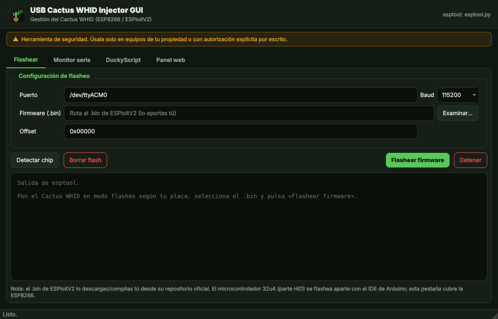
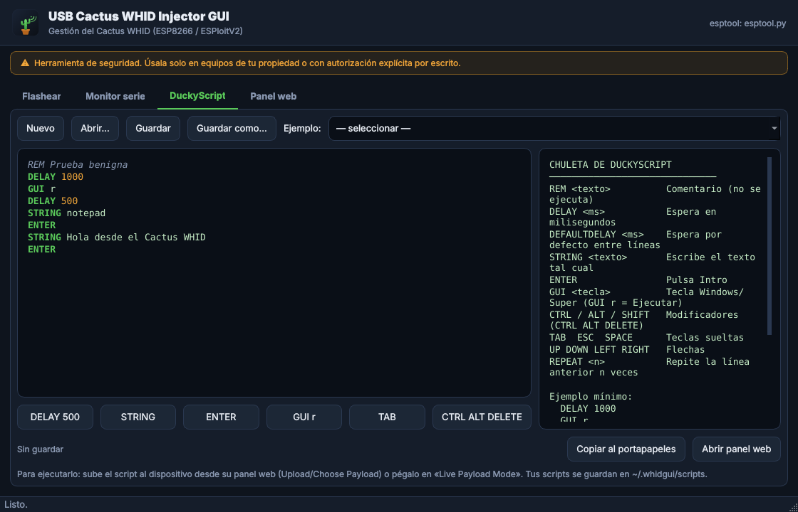

# USB Cactus WHID Injector GUI

Interfaz gráfica de escritorio, en español, para **gestionar un Cactus WHID**
(dispositivo basado en ESP8266 con firmware **ESPloitV2**) desde Kali Linux.

Es una capa cómoda de **gestión y autoría**: flasheo del firmware, monitor
serie, un editor de **DuckyScript** para tus propios payloads, y acceso rápido
al panel web del dispositivo. No reimplementa el aparato; se apoya en las
herramientas estándar (`esptool`, el puerto serie y el panel web de ESPloitV2).




> ⚠️ **Uso responsable.** El Cactus WHID es una herramienta de seguridad de
> inyección de pulsaciones (HID/BadUSB). Úsala **únicamente** en equipos de tu
> propiedad o con **autorización explícita por escrito**. El uso no autorizado
> contra sistemas ajenos es ilegal. Este proyecto **no** incluye payloads de
> ataque ni módulos de robo de credenciales/exfiltración: el editor envía lo que
> tú escribas, y solo trae dos scripts de ejemplo inofensivos.

## Características

- **Flashear** (pestaña *Flashear*): selecciona puerto, baudios y el `.bin` de
  ESPloitV2 y flashea la ESP8266 con `esptool`. Incluye *borrar flash* y
  *detectar chip*.
- **Monitor serie** (pestaña *Monitor serie*): abre el puerto (por defecto
  38400 baud) para enviar comandos de configuración y ver la salida. Botón
  rápido para `ResetDefaultConfig:`.
- **DuckyScript** (pestaña *DuckyScript*): editor con **resaltado de sintaxis**,
  botones para insertar comandos, chuleta integrada, carga de ejemplos y
  guardado de tus scripts en `~/.whidgui/scripts`. Botón para copiar al
  portapapeles y abrir el panel web.
- **Panel web** (pestaña *Panel web*): recordatorio de los datos por defecto del
  AP y botón para abrir `http://192.168.1.1` en el navegador.
- Tema oscuro, icono propio y acceso directo en el menú (KDE incluido) y en el
  Escritorio.

## Requisitos

- **Python 3** (3.8+).
- **PyQt5** — `sudo apt install python3-pyqt5`
- **pyserial** (monitor serie) — `sudo apt install python3-serial`
- **esptool** (flasheo) — `sudo apt install esptool`  (o `pip install esptool`)
- El **firmware ESPloitV2** (`.bin`) lo aportas tú: descárgalo o compílalo desde
  su repositorio oficial. La parte HID (microcontrolador 32u4) se flashea aparte
  con el IDE de Arduino; esta app cubre la **ESP8266**.

## Instalación

```bash
git clone https://github.com/MyNameIsMarkel/USB-Cactus-Whid-Injector-GUI.git
cd USB-Cactus-Whid-Injector-GUI
./install.sh
```

`install.sh` comprueba las dependencias (ofrece instalarlas por apt o en un venv
local), registra el icono y crea el acceso directo en el **menú de aplicaciones**
(system-wide si lo ejecutas como root, para que KDE lo muestre) y en el
**Escritorio**. Refresca además la caché del menú de KDE (`kbuildsycoca`).

## Cómo iniciar

- **Icono del Escritorio** o entrada en el menú (busca «Cactus WHID»).
- **Lanzador**: `./run.sh`
- **Módulo**: `python3 -m whidgui`

> Para el puerto serie / flasheo necesitas acceso al dispositivo USB. Si no vas
> como root, añade tu usuario al grupo `dialout`
> (`sudo usermod -aG dialout $USER` y reinicia sesión).

## Flujo típico (dispositivo nuevo)

1. **Flashear**: conecta el WHID, ve a *Flashear*, elige el `.bin` de ESPloitV2
   y pulsa *Flashear firmware* (un *Borrar flash* previo suele ayudar).
2. Flashea la parte 32u4 con Arduino (fuera de esta app).
3. El dispositivo crea su WiFi (por defecto SSID `Exploit` / `DotAgency`).
   Conéctate y abre el **Panel web** (`192.168.1.1`, admin `admin`/`hacktheplanet`).
   **Cambia esas credenciales por defecto de inmediato.**
4. Escribe tus payloads en la pestaña **DuckyScript**, guárdalos y súbelos desde
   el panel web del dispositivo.

## Flasheo automático (script)

En el Cactus WHID la ESP8266 no se flashea directa: el USB es el del 32u4, que
debe cargar primero un *passthrough*. El script **`flash_whid.sh`** automatiza
los cuatro pasos con `arduino-cli` (sin abrir el IDE):

```bash
./flash_whid.sh all          # setup + passthrough + compilar ESP + flashear + restaurar 32u4
# o por pasos:
./flash_whid.sh setup        # instala arduino-cli, cores, librerías y clona ESPloitV2
./flash_whid.sh passthrough  # sube el passthrough al 32u4
./flash_whid.sh buildesp     # compila ESP_Code -> .bin
./flash_whid.sh flashesp     # flashea la ESP con esptool
./flash_whid.sh restore      # firmware final del 32u4
```

Variables útiles: `PORT`, `ESP_BAUD`, `FQBN_ESP`, `FQBN_32U4`. ESPloitV2 es de
2017 y fija versiones antiguas (core ESP8266 2.3.0, ArduinoJson 5.11.0); el
script las instala para que compile. Si la compilación de la ESP falla por la
opción de tamaño de flash, mira las opciones válidas con
`./flash_whid.sh menuopts` y ajusta `FQBN_ESP`.

## Limitaciones

- Es un **gestor/editor**, no un framework de ataque: no genera ni incluye
  payloads ofensivos, ni los módulos de exfiltración/credential harvesting de
  ESPloitV2.
- El envío de payloads al dispositivo se hace desde su **panel web**; la app no
  automatiza ese POST (el firmware no documenta una API pública para ello).
- Los valores por defecto del AP son **públicos**: cámbialos siempre.
- Probado en **Linux** (Kali).

## Desinstalar

```bash
./uninstall.sh
```

## Licencia

MIT — ver [LICENSE](LICENSE).
